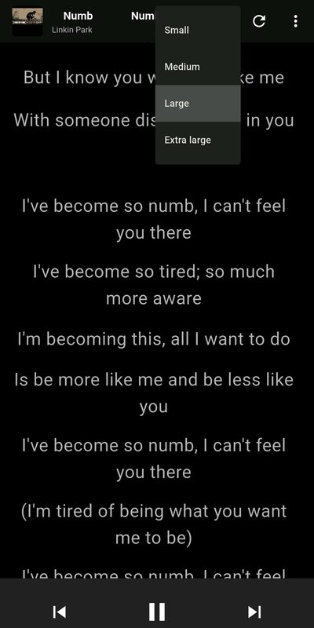
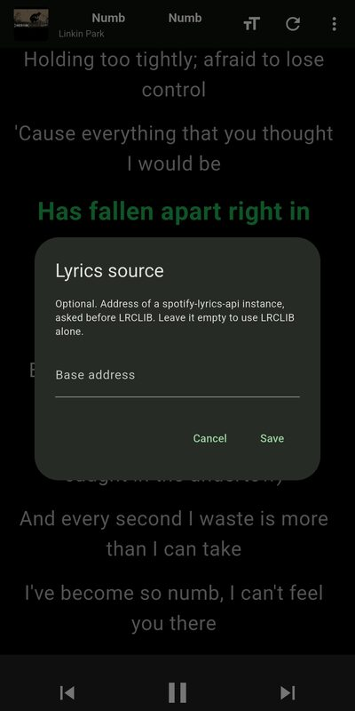
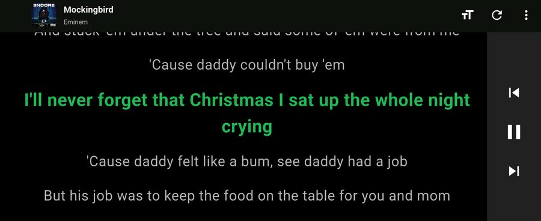

# Car Lyrics

Time-synced Spotify lyrics on a full-screen, car-friendly display.

The app plays no audio of its own. It is a remote control and a lyrics view over the Spotify Web API, driving whatever device is already active on your Spotify Connect session — so something has to be playing somewhere else for it to have anything to show.

Android only. Flutter 3.47, Dart 3.9.

## What it does

- Follows the current line and scrolls to it, keeping it in the top quarter of the screen so you can see what is coming rather than what has gone.
- Four text sizes, from the original size upwards, chosen by multiplying the two base sizes so the ratio between the highlighted line and the rest never drifts.
- In landscape the transport controls move to a column on the right edge, because height is the scarce dimension there and the lyrics need it.
- Pulls lyrics from an optional self-hosted [spotify-lyrics-api](https://github.com/akashrchandran/spotify-lyrics-api) instance first, then [LRCLIB](https://lrclib.net), and caches what it resolves.
- Keeps the screen awake while in the foreground, and stops polling entirely when backgrounded.

## What it looks like

https://github.com/user-attachments/assets/e340b827-6a50-462a-812a-c3b378c6d138

| Following the song | Text size | Lyrics source |
| --- | --- | --- |
|  |  |  |

In landscape the transport controls move to the right edge, leaving the full height to the lyrics:



## Running it

You need your own Spotify app registration. The app asks for it on first launch and keeps it on the phone — it is not baked into the build, and no build in this repo contains one.

1. Create an app at the [Spotify Developer Dashboard](https://developer.spotify.com/dashboard) and add `car-lyrics://callback` as a redirect URI.
2. Build and run:
   ```bash
   flutter pub get
   flutter run -d <device>
   ```
3. Paste the client ID into the first screen. To change it later: three-dot menu → **Spotify client ID**.

There is no client secret anywhere: login uses the authorization-code flow with PKCE, in the system browser.

The optional lyrics proxy is **not** configured at build time. Its address is typed into the app, under the three-dot menu, because an instance of `spotify-lyrics-api` is something each person hosts themselves. Left empty, LRCLIB serves lyrics on its own.

### Why you need your own registration

Two reasons, and the second is the one that decided it.

Spotify app registrations start in Development Mode, which only lets accounts the owner has added by hand in the dashboard complete the login — a handful of them. So a prebuilt APK carrying somebody else's client ID would reject everyone but that somebody's invitees. With your own registration you are the invitee, which is all you need.

The other reason is that the [Developer Terms](https://developer.spotify.com/terms) treat a client ID as a Security Code and require it to be embedded "in a secure manner not accessible by third parties". A `.env` file inside a public APK is not that — one `unzip` reads it — and whoever owns the registration stays responsible for everything done with it. Since July 2026 the Web API quota is counted per developer account rather than per app, so a leaked ID drains the budget of everything that account owns.

That is why the client ID is typed into the app instead of compiled into it, and why there is no APK attached to the releases here.

A Spotify **Premium** account is also required: the Web API refuses playback commands for free accounts. The lyrics still show.

## How it is built

Two `ChangeNotifier`s, one screen, no router. The interesting parts, and the reasoning behind them, are written up in [CLAUDE.md](CLAUDE.md) — among them:

- **Two timers with different jobs.** A 5-second poll stores an anchor (`progress_ms` plus the instant it was read); a 100ms tick extrapolates from that anchor and never touches the network. That split is what makes highlighting look smooth on a slow poll.
- **"Nothing playing" and "I don't know" are kept apart.** A 204 clears the screen; any other failure leaves the last known state alone. Collapsing the two makes a transient 500 wipe the lyrics mid-song.
- **A provider chain with a cache that is stricter than its return value.** The repository will hand back a degraded answer, but refuses to *freeze* one it obtained while a source was unreachable.
- **`PlayerProvider` never calls `DateTime.now()`.** Every reading goes through `package:clock`, so `fake_async` can resolve twelve seconds of polling instantly and deterministically in tests.

111 tests, run with `flutter test`.

## Licence

MIT — see [LICENSE](LICENSE).
